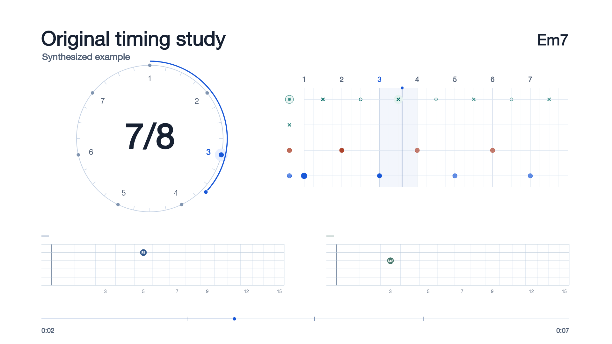

# Two Moons Visualizer

## Project Overview

A drum-focused music-video renderer developed for toe’s “Two Moons”. A large circular meter clock and per-bar drum events lead the composition. Two quieter guitar fretboards and a concise chord display keep the band’s harmonic context visible.

This is an unofficial technical study. It has no affiliation, endorsement or collaboration with toe.

The repository includes an original synthetic calibration study. The commercial recording, original full score, derived full-song note data, finished music video and album artwork are excluded. The screenshots below use the calibration study.

## Screenshots



## Features

- Circular meter clock driven by explicit pulse boundaries.
- Per-bar drum lanes with ghost-note outlines, accents and short attack flashes.
- Meter changes, including 4/4 and 3/4 in the original study.
- Two guitar parts with played pitches and held-note illumination.
- Concise inferred-chord display and progress markers for meter changes.
- Deterministic PNG previews and H.264/AAC export.

## Tech Stack

- Node.js 22 or later, native ECMAScript modules.
- `@napi-rs/canvas` 0.1.80 for offscreen Canvas/Skia rendering.
- FFmpeg and ffprobe on PATH for MP4/AAC export and audio inspection.
- Optional Python 3.11 or later, NumPy and SciPy for local score preparation.

The optional Python tools read six locally supplied gzipped track JSON files in the original score schema. A local separated drum stem may refine transient alignment.

## Getting Started

Install Node.js 22+ and FFmpeg, then run from the repository root.

```sh
npm ci
npm run build
npm test
npm run preview -- --start 2.65
npm run demo
```

The preview is written to `output/preview.png`. The demo command synthesizes an original stereo WAV locally, then renders `output/demo.mp4` at 1920×1080 and 30 FPS. The standard video renderer defaults to 60 FPS.

`npm run build` checks source syntax, validates the example and initializes the renderer at its timeline boundaries. The project runs directly in Node.js and has no bundling stage or web server.

### Use your own local materials

Only use recordings and score data you have permission to process. Keep them in the ignored `local/` folder.

The simplest input is a prepared JSON event bundle matching `examples/demo.json`. Its schema is described in [the data-format guide](docs/DATA_FORMAT.md).

```sh
npm run render -- --data local/events.json --audio local/recording.wav --output output/my-video.mp4
```

Audio is optional for silent video export. When the bundle includes an audio SHA-256, the renderer checks the supplied recording before encoding. A new recording needs a newly aligned bundle. `presentation.start` trims initial silence while preserving the events’ original audio-time coordinates.

To prepare an authorized folder containing six gzip-compressed track JSON files named 0.json through 5.json, install the optional Python tools.

```sh
python3 -m venv .venv
# macOS/Linux
.venv/bin/python -m pip install -r requirements.txt
.venv/bin/python tools/prepare.py --audio local/recording.wav --score local/score-tracks --output local/events.json
```

On Windows, use `.venv\Scripts\python.exe` for both Python commands. The pipeline performs local analysis and contains no media downloader. It expects the original arrangement format described below. For another arrangement, supply a prepared event bundle or adapt its score mapping.

For CJK titles, install a suitable font or pass `--font local/font.ttf`. Font files stay local. System font fallback may produce platform-dependent typography.

## Controls

This is an offline renderer. Its original production workflow uses command-line controls.

| Option | Effect |
| --- | --- |
| `--data path.json` | Select a prepared event bundle. Defaults to the original synthetic example. |
| `--audio path.wav` | Attach and validate a local recording. |
| `--start seconds` | Seek in recording time. Defaults to `presentation.start` or zero. |
| `--duration seconds` | Export a short range, capped by the timeline end. |
| `--fps 60` | Choose an integer frame rate from 1 to 120. |
| `--snapshot` | Render one PNG at the selected time. |
| `--output path` | Select an MP4 or PNG destination. |
| `--font path.ttf` | Register a locally installed font. |

For example, `npm run render -- --start 2 --duration 3 --fps 30` exports a three-second silent segment of the bundled example.

## Project Structure

```text
src/        Renderer, timing and music-theory modules
scripts/    CLI rendering, synthetic audio demo and static checks
tools/      Optional local score alignment and harmony preparation
examples/   Original synthetic event bundle
tests/      Timing, validation and renderer regression tests
docs/       Example screenshot and input-format guide
local/      Ignored user-supplied recordings, scores and prepared events
output/     Ignored generated previews, audio and videos
```

Each repository includes its own required modules and dependencies. It can run without its sibling repositories.

## Technical Highlights

The meter clock and drum cursor use the same per-bar pulse boundaries, supporting unequal pulse durations and changing denominators. Numeric pulse lookup is covered by a regression test. Ghost hits use hollow marks and accented hits receive larger glyphs.

The original custom layout keeps the meter and drums visually dominant. Guitar labels and drum-name captions are intentionally absent. Ties are merged during preparation. The optional transient fit moves an entire bar coherently instead of quantizing individual hits.

The preparation pipeline expects the original six-track layout: two guitars, two keyboard parts, bass and percussion. Its alignment landmarks target the original studio recording and need review for another edition. Chord candidates come from guitar and bass pitch coverage. No curve or additional part is invented where data is absent.

The code was recovered from the original production source and subsequent patch records after temporary working files were cleared. Existing visualization logic was retained, with local paths replaced by CLI inputs and package imports. Full-song source assets are excluded.

## Validation

The release checks cover dependency installation, syntax, renderer startup, deterministic seeking, event validation, synthetic audio/video export and full decoding of the resulting MP4.

The optional score tools receive Python dependency/import checks, syntax checks and CLI startup checks. The complete original-score alignment pipeline has not been rerun because its licensed full-score inputs are absent. Included examples demonstrate the visual engine and timing interfaces. They make no claim to reproduce Two Moons.

## Credits

The original visualization study refers to **Two Moons — toe**. Music and recordings belong to their respective rights holders. Arrangement references retain their original authors’ rights. [Arrangement reference](https://www.songsterr.com/a/wsa/toe-two-moons-drum-tab-s82969) · [Official recording page](https://toe-music.bandcamp.com/track/two-moons)

The fretboard utility is by GSflaming. Its existing license is retained in `src/vendor/fret-note/LICENSE`. See [third-party notices](THIRD_PARTY_NOTICES.md) for dependency attribution.

## License

Project-authored code and the original calibration examples are MIT licensed. The license excludes third-party music, scores, recordings, artist marks and artwork. No permission to redistribute those materials is granted by this repository.
